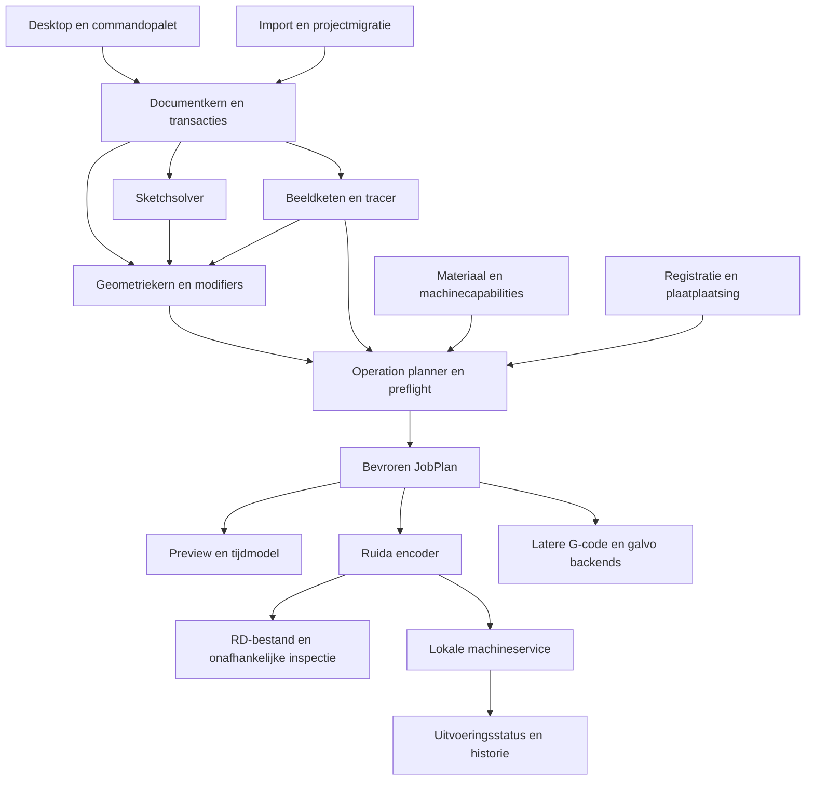

# Architectuur voor de volledige applicatie

De editor moet vrij kunnen groeien zonder dat er meerdere interpretaties van dezelfde laserjob ontstaan. Daarom delen GUI, CLI, preview en backends één document- en planningskern. Dit is een voorgestelde architectuur; de workspace bevat onderzoeksdossiers, nog geen beoordeelde implementatie.

## Grenzen tussen modules



Zware geometrie, solver, tracing, nesting en compilatie draaien als annuleerbare achtergrondtaken. Een resultaat wordt alleen toegepast wanneer de invoerrevisie nog overeenkomt. De UI-thread voert geen netwerk-wachtlus of onbegrensde solverberekening uit.

## Documentmodel

| Entiteit | Verantwoordelijkheid |
|---|---|
| Project | Schema, eenhedenweergave, platen, assets, geometrie, parameters, proceslagen en revisies |
| Asset | Originele beeldbytes, fontverwijzing of importbron met inhoudshash |
| GeometryObject | Stabiele identiteit, lokale geometrie, transformatie, zichtbaarheid en ontwerplaag |
| Sketch | Lijnen/bogen/cirkels, constraints, dimensies, solverstatus en laatste geldige oplossing |
| ComponentDefinition | Herbruikbaar onderdeel met parameters en brongeometrie |
| ComponentInstance | Plaatsing en expliciete overrides van een onderdeel |
| Modifier | Benoemde bewerking met bronverwijzingen, parameters en afgeleide resultaten |
| TraceRecipe | Bronasset, fysieke schaal, engineversie, maskerketen, instellingen en correcties |
| Operation | Verwijzingen naar geometrie plus bewerkingstype, procesinstellingen en volgorderegels |
| ProcessLayer | UI-groepering van operations, naam, kleur en outputstatus |
| Sheet | Plaatcontour, materiaal, dikte, uitsluitingen en onderdeelplaatsingen |
| MaterialRecipe | Gereviseerde instellingen gebonden aan een passende machineconfiguratie |
| MachineProfile | Bed, origin, assen, verbinding, bewezen capabilities en calibratierevisies |
| Registration | Gemeten transform, type, punten, residuen en geldigheidsvoorwaarden |
| CompiledJob | Bevroren JobPlan, bron-/profielsnapshots, compilerinformatie en outputassets |
| Execution | Eén uitvoeringsintentie met apparaat, aantallen, toestand en bewijslog |

**Wijziging tegenover het oudere architectuurvoorstel:** geometrie heeft geen verplicht enkelvoudig proces-`layerId` meer. Ontwerplaag, proceslaag en operationreferentie hebben eigen betekenis. Een compatibiliteitsimport mag kleur → proceslaag mappen, maar het interne model ondersteunt meerdere operations op één bronobject. Dit werkt het eerdere idee [I01](../andere-software/03-beste-ideeen-voor-burnburn.md) consequent uit.

## Geometrie en numerieke afspraken

Canonieke ontwerpeenheid is mm met double precision. Primitives bewaren hun betekenis: lijn, cirkel, cirkelboog, ellips en cubic Bézier. CAM krijgt opgeloste geometrie en een expliciete flatteningtolerantie. Screenflattening gebruikt een eigen schermbudget; uitzoomen mag de productiegeometrie niet grover maken.

Een integer clipping-/offsetkern kan intern een gekozen vaste schaal gebruiken, met tests voor bereik en degeneraties. Ruida kwantiseert pas bij de backendgrens naar zijn gecodeerde eenheden. Bewaar een foutbudget voor import, geometrische afleiding, flattening, transformatie en kwantisatie. Machinecalibratie en materiaalgedrag staan daar als gemeten productie-onzekerheid naast.

Nominale maat, fysieke fittingtolerantie, endpoint-verbinden, duplicaatdetectie, rasterinterval en kerfbreedte zijn afzonderlijke waarden. Eén globale “precision”-schuif is te ambigu. Binnen/buiten wordt bepaald uit consistente topologie en operationintentie; open centerlines hebben geen vanzelfsprekende binnenkant.

Een onderdeel heeft lokale coördinaten; een plaat heeft plaatsingen; registratie maakt een jobtransform; een machineprofiel maakt de bed-/controllertransform. Leg volgorde en inverses vast met fixtures voor alle toegestane originhoeken en rotaties. Behoud cirkels onder geldige transformaties; onder niet-uniforme schaal wordt een cirkel een ellips en verliezen sommige constraints hun betekenis.

## Solver en afhankelijkheden

Gebruik een Rust-native solveradapter met getypeerde entiteiten en resultaattoestanden. Begin met lijnen, cirkels en bogen; voeg splineconstraints alleen toe als prestaties en diagnose dat dragen. SolveSpace blijft een externe vergelijkingsreferentie; de productieroute volgt de Rust-keuze uit het [implementatieplan](../implementatieplan/README.md).

De parameter- en modifierketen vormt een gerichte acyclische graaf. Solve alleen gewijzigde sketches en downstreamafleidingen. Stel per taak tijd- en geheugenlimieten in. Last-valid-result is zichtbaar als oud resultaat wanneer de huidige toestand ongeldig is; een job wordt niet met die oude geometrie gecompileerd alsof de nieuwe wijzigingen geslaagd zijn.

Topologiereferenties bevatten bron-ID, entiteit-ID, generatie en eventueel een geometrische herstelsuggestie. Als een relatie niet met voldoende zekerheid kan worden hersteld, wordt zij gebroken gemarkeerd. Stabiele identiteit is geen belofte dat iedere booleanwijziging automatisch oplosbaar blijft.

## Tracing als afleidbare bron

De engine-interface ontvangt pixels, fysiek schaalbeleid, regio/masker en versiespecifieke instellingen. Uitvoer bevat geometrie, contourboom of centerlinegraaf, fitmetingen en probleemlocaties. Een SVG-string alleen mist de structuur die de editor nodig heeft.

Cachekeys omvatten bronhash, schaal, voorbewerking, regio, engineversie, instellingen en correcties. Bij gewijzigde fittinginstellingen kan een geldige segmentatiecache worden hergebruikt; bij andere lokale threshold niet. Deterministische seeds en genormaliseerde objectvolgorde maken resultaten vergelijkbaar.

## Productiecompilatie

1. Kies projectrevisie, plaat, machineprofiel en operationselectie.
2. Resolveer parameters, sketches, modifiers, teksten, beelden en componentplaatsingen.
3. Controleer geldigheid, capabilities, referenties en eenheden.
4. Pas productieafleidingen toe: kerf, tabs, leads, rasterresolutie en gekozen passes.
5. Leg harde volgordeafhankelijkheden vast en optimaliseer resterende vrijheid.
6. Pas geregistreerde plaatsing en machineframe toe; controleer werkgebied en bekende extra bewegingsruimte.
7. Maak één immutable JobPlan met concrete instellingen en herleidbare events.
8. Toon preview en preflight voor deze revisie; encodeer exact dit plan naar RD.
9. Decodeer/inspecteer de export waar nodig en bewaar hash en versies.
10. Maak een aparte Execution voor upload en eventuele start.

Het JobPlan bevat onder meer Travel, Cut, ScanRun, Dwell, Air, AxisAction en OperationBoundary. Welke events de backend ondersteunt wordt gecontroleerd. Beeldmodulatie en basisvermogen zijn verschillende velden; de lokale Grayscale-fixture bewijst de volledige firmwareformule nog niet. Zie [exportanalyse](../lightburn/ruida/04-exportanalyse.md).

Een planhash gebruikt canonieke inhoud en relevante invoer: geometrie, tekstshapingresultaat, effectieve parameters, materiaal, plaatsing, registratie, machinecapaciteiten en compiler-/pluginversies. Transportadres en logtijd horen niet in de geometrische planhash. Het outputbestand krijgt daarnaast een eigen bytehash. Equivalentie tussen uitvoeromgevingen vereist vastgelegde engine-/fontversies en numerieke normalisatie; willekeurige builds hoeven niet byte-identiek te zijn.

## Ruida en transport

Scheid encoder, decoder en transport. RD is binaire Ruida-code. Een G-codepreview of generiek seriële tekstdriver vervangt die keten niet. De bestaande lokale exports zijn golden fixtures voor een beperkte subset, geen universeel supportcertificaat.

Gebruik één lokale eigenaar van de controllerverbinding. Machinecommando's hebben eigen command-ID's en toestandsvoorwaarden. Commando's die productie starten zijn niet veilig te herhalen alleen omdat er geen antwoord kwam. Een lokaal intentielog voorkomt dubbele verzending waar mogelijk; het kan geen exactly-once-garantie afdwingen als de controller geen passende identificatie en reconciliatie ondersteunt.

```text
Draft → Compiled → Uploading → Stored → StartRequested → Running → Completed
                     ↘ Failed       ↘ Unknown            ↘ Unknown
Annulering: intentie vastleggen; pas Cancelled wanneer bevestigd of expliciet gereconcilieerd.
```

Iedere overgang bewaart bewijs, tijd en bron: protocolantwoord, controllerstatus of operatorregistratie. `Stored` vraagt opslagbewijs volgens de gevalideerde route. `Completed` vraagt betrouwbare controllerterugmelding of een benoemde operatorbevestiging. `Unknown` kan na reconciliatie naar een bewezen toestand gaan. Annuleren van een upload verwijdert een eventueel gedeeltelijk controllerbestand niet vanzelf.

Ethernet is de voorgestelde eerste live route vanwege de al onderzochte protocolbasis. De doelmachine kan die keuze wijzigen. USB krijgt een afzonderlijke implementatie- en validatiepoort. Opslaan, uploaden en starten zijn verschillende acties; een veilige default uploadt zonder automatisch te starten. Een ervaren gebruiker kan een expliciet ingestelde snelle workflow gebruiken op de gevalideerde configuratie.

## Opslag en platform

Voorgesteld projectformaat: een `.burnburn`-container met manifest, getypeerd document, content-addressed assets en afgeleide previews. Machineverbindingen en werkplaatsbibliotheken staan in lokale applicatieopslag; een project bewaart alleen de benodigde snapshots en expliciet overdraagbare configuratie. Jobhistory en executionlog passen in een lokale transactionele database.

Een nieuw formaat krijgt schema-upgrades met kopiebehoud en fixtures. Caches mogen worden weggegooid; bronnen, correcties, identiteit en productiesnapshots niet. Geopende nieuwere documenten krijgen een leesbare melding en geen onvolledige overschrijfactie.

De vastgelegde implementatierichting is **Rust voor de volledige applicatie, native AppKit vanuit Rust op macOS en later een afzonderlijke native Windows-GUI**. Document, editorinteractie, presentatie, geometrie, solver, tracing, CAM en machineketen zijn gedeelde Rust-modules. Een gedeeld GPU-canvas gebruikt platformgebonden surfaces. Alle eigen Rust-functionaliteit volgt test-driven design. Deze gebruikerskeuze vervangt de eerdere Qt/C++- en desktop-webopties; de technische uitwerking staat in het [implementatieplan](../implementatieplan/README.md). Plugininterfaces krijgen versiegrenzen en waar nodig procesisolatie.

## Onderhoud en kwaliteit

Dezelfde commandregistry stuurt menu, toolbar, sneltoets en CLI aan waar passend. Alle documentmutaties zijn transactioneel. Machineacties gaan buiten undo om. Diagnostiek is standaard lokaal en te exporteren; delen van bronbestanden of telemetry is een afzonderlijke gebruikerskeuze.

Tests worden per contract ingericht: geometrie-invarianten, opslagschema's, solvergevallen, tracecorpus, JobPlan-goldens, onafhankelijke RD-decode, transportfaults en echte hardware. Fysieke supportclaims horen bij model + firmware + interface + featurematrix. De releasecriteria staan in het [bouwplan](05-bouwplan.md).
