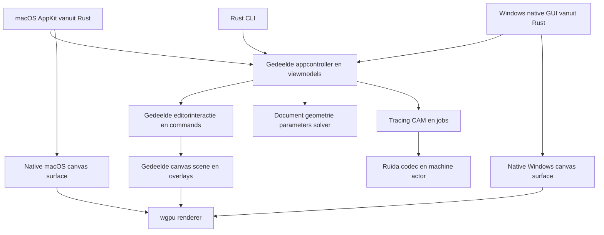

# Implementatieplan voor BurnBurn in Rust

Datum: **17 oktober 2026**. Dit plan concretiseert het [applicatievoorstel](../applicatieplan/README.md) en de [74 user stories](../applicatieplan/03-user-stories.md). **Alle eigen applicatiecode wordt Rust. macOS krijgt een echte AppKit-interface via Rust-bindings; Windows krijgt later een eigen native interface bovenop dezelfde applicatiekern. Alle Rust-functionaliteit wordt test-first ontwikkeld.**

Dit besluit vervangt de eerdere voorkeur voor Qt/C++ en de optie voor een desktop-webinterface. Er is in deze stap een implementatieplan gemaakt; de applicatie is nog niet geïmplementeerd.

## Leesroute

| Document | Gebruik |
|---|---|
| Dit plan | Architectuur, native GUI, Rust-modules, interfaces en technische keuzes |
| [Test-driven design](01-test-driven-design.md) | Verplichte werkwijze, testlagen, fixtures en CI |
| [Werkpakketten](02-werkpakketten.md) | Concrete implementatievolgorde met eerst te schrijven tests en storydekking |
| [Technische bronnen](03-technische-bronnen.md) | Primaire bronnen, dependencykandidaten en nog te bewijzen integraties |

## Besluiten die vaststaan

| Onderwerp | Besluit |
|---|---|
| Taal | Rust voor kern, editorcontroller, GUI-adapters, machineverbinding en CLI |
| macOS GUI | AppKit via `objc2`, `objc2-app-kit` en `objc2-foundation` |
| Windows GUI | Eigen native frontend; WinUI 3 via Rust is de voorkeursproef, met Win32 als praktische terugval voor niet-gedekte integratie |
| Hergebruik | Document, commands, editorinteractie, geometrie, solver, tracing, CAM, Ruida, renderdata en geschiedenis delen |
| Canvas | Eigen vectorcanvas, gedeeld via `wgpu`; platformadapters leveren de native surface |
| Testwijze | Red → Green → Refactor per gedragswijziging, inclusief bugs en platformadapters |
| Uitvoermodel | Eén eigenaar van documentsessie; zware taken op workers; één eigenaar van elke machineverbinding |
| Eerste product | macOS, offline bewerking en daarna één benoemde Ruida-configuratie |
| Windows voorbereiding | Gedeelde kern vanaf het begin op Windows testen; een vroege kleine native hostproef |

Rust-code roept de bestaande systeemframeworks aan. Dat voldoet aan de taalkeuze zonder Apple's frameworks opnieuw te bouwen. We schrijven geen eigen Swift-, Objective-C-, C++-, C#- of JavaScript-applicatielaag. Buildmanifesten, resources en declaratieve shadercode mogen hun vereiste formaat gebruiken. Externe systeembibliotheken of GPU-drivers zijn geen eigen applicatiecode; niet-Rust algoritmebibliotheken worden niet stil als “pure Rust” geïntroduceerd.

## Native GUI en gedeelde kern



Hergebruik komt uit **gedeeld gedrag en gedeelde data**, niet uit één universele widgetboom. De Mac gebruikt echte Mac-menu's, tekstvelden, lijsten, dialoogvensters en toetsenbordgedrag. De Windows-versie kiest de Windows-equivalenten. Een CAD-canvas is een gespecialiseerde native view met eigen rendering en een expliciete toegankelijkheidsstructuur.

De Windows-versie hoeft geen geometrie, tracer, tool-state machines of productieplanner te herschrijven. Zij moet wel de platformlayout, widgets, toegankelijkheidsbrug, inputnormalisatie en packaging leveren. Daarom beloven we geen vast hergebruikpercentage of kosteloze port.

## macOS interface

Het eerste venster gebruikt `NSApplication`, een windowcontroller, een splitview met zijpanelen, een native toolbar en een canvasview. De objectboom gebruikt een native outline/table-presentatie; de inspecteur gebruikt native velden en keuzelijsten. `NSOpenPanel`/`NSSavePanel`, pasteboard, drag-and-drop, menuvalidatie en focus blijven platformtaken.

De appcontroller bezit de undo-/redo-semantiek. AppKit-menu's en waar passend `NSUndoManager` verwijzen naar dezelfde commandogeschiedenis; twee onafhankelijke undo-stacks zijn uitgesloten. Elk geopend document heeft een eigen documentsessie. Het sluiten van een gewijzigd document activeert het native bewaartraject. Autosave schrijft een recoverybestand zonder de expliciete Save-betekenis te veranderen.

IME en samengestelde invoer gaan via de native tekstinvoerroute. Concepttekst tijdens compositie is geen permanente geometriewijziging. UI-tekst gebruikt de native tekstweergave; productielettervormen worden in de gedeelde Rust-tekstketen gevormd en als glyphcontouren behandeld. Daardoor bepaalt een OS-widget niet de uiteindelijke lasergeometrie.

AppKit-objecten leven uitsluitend op de hoofdthread. `MainThreadMarker`, retained ownership en kleine, benoemde wrappers begrenzen `unsafe`. De tests omvatten openen/sluiten, callbacks na het sluiten, focus, dialoogannulering, Retina-schaal en surfaceverlies. Bij OS-callbacks ontsnapt geen Rust-panic over een FFI-grens.

Een `.app`-bundle met Info.plist, icoon en documenttype wordt vanuit een Rust-`xtask` samengesteld. Signing, notarization en distributie volgen zodra een releaseartefact en de benodigde ontwikkelaarsidentiteit bestaan. Deze werkzaamheden veranderen geen kernlogica. De eerste target is Apple Silicon; Intel wordt pas als ondersteund gepubliceerd wanneer build en testen beschikbaar zijn. Een concreet minimaal macOS-versienummer wordt bij de eerste dependencylock en native surfaceproef vastgelegd.

## Windows route

De voorkeursrichting is **WinUI 3 vanuit Rust**, met bindings uit het `windows-rs`-ecosysteem en evaluatie van `windows-reactor`. Microsoft publiceert hiervoor native samples; de ontwikkelbranch gebruikt soms prerelease-crates. Daarom wordt een werkende versie/commit eerst vastgezet en op Windows beproefd. [Microsoft samples](https://github.com/microsoft/windows-rs/tree/master/crates/samples).

De vroege proef bevat één venster, objectlijst, maatveld, native file picker, toetsenbordfocus en het gedeelde canvas. Zij leest hetzelfde project en stuurt dezelfde `SetDimension`-command. Bij WinUI krijgt de surface-/composition-integratie een aparte proef; een WinUI-windowhandle is niet vanzelf een correct composited canvaspaneel. Een geschikte child window of expliciete composition-route wordt getest op clipping, resizing, focus en DPI.

Als de Rust/WinUI-route voor deze basisfunctionaliteit geen houdbare dependencyset oplevert, kan de Windows-host native Win32-controls gebruiken via `windows`. Dat wijzigt de gedeelde modules niet. De keuze krijgt een beslisnotitie; er ontstaat geen C#- of C++-host. De volledige Windows-frontend volgt later, maar het bewijs van de architectuurgrens hoort bij de eerste Mac-editorfase.

## Gedeeld canvas

Gebruik `wgpu` als GPU-laag. De documentatie noemt Metal voor macOS en DX12 voor Windows; dat maakt de renderer kandidaat voor hergebruik op beide hosts. De werkelijke surface-integratie moet per host slagen. [wgpu backends](https://docs.rs/wgpu/latest/wgpu/).

Begin met padtessellatie en een begrensde renderer: contouren, fills, lijnen, afbeeldingen, selectie, knopen, maatlabels en procesoverlays. `lyon` is een tessellatiekandidaat; Vello is een alternatieve rendererkandidaat voor de vroege benchmark. De domaingeometrie blijft `f64`; een viewportrelatieve representatie voorkomt onnodig verlies bij omzetting naar GPU-coördinaten.

`SceneSnapshot` is een immutable weergave van documentrevisie, zichtbare geometrie en overlays. `RenderPacket` bevat uitsluitend GPU-klare afleidingen. Geen van beide is het document of het JobPlan. Schermtessellatie, productieflattening en hit-testing hebben eigen toleranties. GPU-pixels zijn geen bron voor de Ruida-encoder.

De renderer heeft tests voor clipping, fillregels, camera, transforms, sRGB/alpha, DPI, resize, verborgen/minimale vensters en GPU-deviceverlies. Offscreen pixeltests gebruiken beperkte tolerantie; semantische geometrieasserties blijven doorslaggevend. Een headless of noop GPU-backend bewijst geen echte Metal-/DX12-rendering.

## Cargo workspace

Dit is de beoogde uiteindelijke indeling. Maak een crate wanneer er een werkend contract en een eerste test voor is; maak niet meteen alle lege packages.

| Crate | Verantwoordelijkheid | Mag niet afhangen van |
|---|---|---|
| `burnburn-types` | Stabiele IDs, eenheden, revisies en getypeerde fouten | GUI, GPU, filesystem en netwerk |
| `burnburn-geometry` | Primitives, transforms, curves, topologie en spatial index | AppKit, Windows, wgpu |
| `burnburn-document` | Projectmodel, transacties, undo, referenties en snapshots | GUI en concrete IO-adapters |
| `burnburn-sketch` | Parameters, constraints en solveradapter | GUI en machineverbinding |
| `burnburn-editor` | Selectie, gereedschapstate machines, snapping en editpreview | Platformwidgets en concrete renderer |
| `burnburn-image` | Bronbeelden, schaal, filters en rastervoorbereiding | GUI en Ruida-transport |
| `burnburn-trace` | Contouren, centerlinegraaf, fitting en lokale correcties | Platformwidgets |
| `burnburn-cam` | Operations, preflight, volgorde en JobPlan | GUI, transport en RD-bytes |
| `burnburn-ruida` | Zuivere RD-codec en protocolberichttypen | GUI, sockets en clocks |
| `burnburn-machine` | Capabilitychecks, execution-state machine en transportports | Platformwidgets |
| `burnburn-io` | Projectcontainer, migraties, import/export en assetopslag | GUI-frameworks |
| `burnburn-runtime` | Workers, timers, filesystem/netwerkadapters en lokale historie | AppKit/WinUI-widgettypen |
| `burnburn-presentation` | Commands, viewmodels, tasks en documentsessies | AppKit, Windows en wgpu |
| `burnburn-render` | Scenevertaling en GPU-rendering | Machineverbinding |
| `burnburn-macos` | Native Mac-host, input, menu, views en surface | Windows-host |
| `burnburn-windows` | Native Windows-host, input, views en surface | Mac-host |
| `burnburn-cli` | Headless controle, compileren, inspectie en batchwerk | Native GUI-hosts |
| `burnburn-test-support` | Fixtures, fake clock, fake transport en contractharness | Productiebinaries als runtime-dependency |
| `xtask` | Build-, bundle-, corpus- en verificatietaken in Rust | UI-state |

Latere modules voor nesting, registratie en orders kunnen eerst begrensde modules zijn en worden afgesplitst wanneer het eigen contract dat rechtvaardigt. Afhankelijkheden zijn gericht: documentmodel bevat data voor sketches en traces; evaluators lezen snapshots en leveren patches, waardoor document en evaluator elkaar niet hoeven te importeren.

Platformdependencies staan onder target-specifieke Cargo-tabellen en in de hostcrates. De kern moet zelfstandig zonder GPU of Apple-SDK compileren. Rust edition en een exacte stabiele toolchain worden in het eerste werkpakket vastgelegd op basis van de gekozen dependencyset; upgrades zijn een afzonderlijke wijziging met tests.

## Command en event contract

Een native callback vertaalt de platformgebeurtenis naar een betekenisvolle actie: selecteer object, begin slepen, wijzig maat, pas trace toe of vraag upload aan. Hij verandert niet rechtstreeks documentvelden.

```text
Native widget/input
    → UiIntent of genormaliseerde PointerEvent
    → AppController en editor tool-state machine
    → DocumentCommand of MachineIntent
    → transactie / achtergrondtaak / machine actor
    → AppEvent met revision en request-id
    → nieuw viewmodel en scene
```

Publieke contracten bevatten minimaal:

| Contract | Belangrijke velden / regel |
|---|---|
| `DocumentCommand` | DocumentId, verwachte RevisionId, payload; maakt één transactie |
| `CommandOutcome` | Nieuwe revisie, gewijzigde IDs, waarschuwingen en undo-record |
| `PointerEvent` | Logische canvaspositie, modifiers, knop, fase en monotone tijd |
| `ToolState` | Idle / preview / committing / cancelled; preview blijft tijdelijk |
| `TaskRequest` | TaskId, bronrevisie, inhoudssleutel en cancellationtoken |
| `TaskOutcome` | TaskId, bronrevisie en typed result; oud resultaat wordt niet toegepast |
| `MachineIntent` | ExecutionId, machine-identiteit, actie en vereiste toestand |
| `AppViewModel` | Alleen presentatiegegevens; geen native objecten of uitvoerende closures |

AppController en documentsessie worden sequentieel aangestuurd op de UI-thread; snelle edits en previews blijven licht. Workers krijgen immutable `Arc`-snapshots en leveren resultaten terug via een wake-up-/eventpoort. Een CLI kan dezelfde controller zonder native eventloop draaien. Machineactors gebruiken een afzonderlijke runtime. UI-code houdt geen documentlock vast tijdens filesystem- of netwerkwerk.

Een pointerdrag bevat Begin, tijdelijke updates en Commit of Cancel. De historie krijgt uitsluitend de commit. Camera pan/zoom is meestal sessiestate en geen documentmutatie. Platformverschillen in Cmd/Ctrl en scroll worden door de hosts vertaald naar dezelfde semantische acties.

## Algoritmen en dependencies

| Onderdeel | Richting | Beslisproef |
|---|---|---|
| Curves | Eigen typed primitives, `kurbo` achter adapter waar bruikbaar | Degeneraties, bounds en maximale afstandsfout |
| Booleans/offsets | Rust-kandidaat `i_overlay`, begrensde curveflattening | Gaten, raakpunten, korte segmenten en tolerantie |
| Sketchsolver | Rust-native adapter; `sketch-solver` als vroege kandidaat | Gewenste constraints, conflicts, continuïteit en rekentijd |
| Numerieke solver fallback | Eigen beperkte Rust-residukern achter dezelfde interface | Alleen kiezen als kandidaatcontracten falen; apart werkpakket |
| Contourtrace | Rust-pipeline en benchmark; VTracer als kandidaat | Gaten, hoeken, lokale correctie en schaal |
| Centerline | Rust-skeleton/graaf/fittingmodule | T/X/Y-grafen, spurs en dubbelzinnige verbindingen |
| Tekstgeometrie | RustyBuzz plus Rust-fontparser als kandidaat | Glyphposities, contouren, ontbrekende fonts en heropenen |
| Serialisatie | Getypeerde serde-representatie met canonieke hashprojectie | Migratie, eindige waarden, onbekende velden en roundtrip |
| Async IO | Rust-runtimeadapter, bijvoorbeeld Tokio | Timeouts en cancellation met fake clock vóór live IO |

Kandidaten zijn nog niet geïntegreerd of goedgekeurd. De nieuwe Rust-solverkandidaat is jong; gedocumenteerde determinismeclaims worden onafhankelijk op beide CPU-/OS-routes getest. De eerdere SolveSpace-, Potrace- en AutoTrace-richtingen blijven **externe vergelijkingsreferenties**; wrappers om niet-Rust algoritmekernen zijn geen primaire productieroute onder deze taalkeuze.

Een dependency mag geen eigen modeltypen door de hele app verspreiden. Versies, licenties, buildscripts en native transitieve componenten worden geregistreerd. Eigen rekenkern blijft Rust; noodzakelijke OS- en driverkoppelingen zijn expliciete adaptergrenzen.

## Data, productie en herstel

De `.burnburn`-container blijft manifest + getypeerd project + content-addressed assets. Een expliciet schema en migraties voorkomen dat Rust-structwijzigingen automatisch een nieuw bestandsformaat worden. `f64` NaN/Infinity worden aan inputgrenzen afgewezen. Project- en outputhashes worden op een canonieke representatie berekend, niet op toevallige `Debug`-output of HashMap-iteratie.

De compiler maakt een immutable JobPlan. Preview en RD-encoder lezen hetzelfde plan. De Ruida-codec is zuivere Rust; een netwerkadapter bezit UDP-/USB-verkeer. Het bestaande Python-onderzoeksdecodegereedschap mag als onafhankelijke testoracle blijven bestaan, maar is geen runtime-dependency van de app.

Fake clocks, fake filesystem en fake transport ondersteunen foutinjectie. De productiehistorie onderscheidt upload, opslag, startverzoek, uitvoering en voltooiing. Hardwarestatus blijft onbekend wanneer bewijs ontbreekt. Geen retries van start via een generiek “probeer opnieuw”-mechanisme.

## Eerste aantoonbaar werkende doorsnede

Het eerste geïntegreerde resultaat is een Mac-venster met native objectlijst en maatveld plus het gedeelde canvas. De gebruiker maakt een rechthoek van 120 × 80 mm, wijzigt breedte naar 150 mm, doet undo, bewaart en heropent het bestand. Een headless test bereikt exact dezelfde documentinhoud via commands.

Daarna volgen snapping/nodes, een geparametriseerde montageplaat, contourtracing en offline RD. De Windows-proef herhaalt de maatwijziging met dezelfde kern vóór omvangrijke Mac-specifieke schermen worden gebouwd. Alle stappen en eerste falende tests staan in de [werkpakketten](02-werkpakketten.md).
