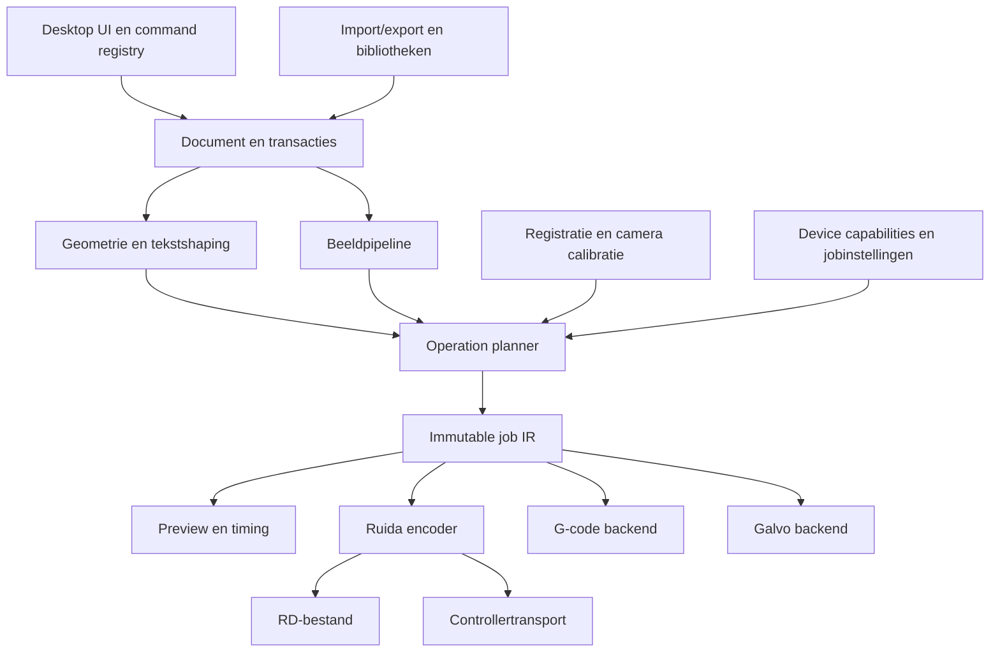

# Architectuur voor een vergelijkbare tool

Dit hoofdstuk is **ONTWERP**. Het beschrijft een zelfstandig te bouwen systeem en pretendeert geen kennis van LightBurn-interne klassen of sourcecode.

## Modulegrenzen



## Datamodel en scopes

Gebruik canonieke millimeters voor bewerkbare geometrie, double precision voor editortransformaties en integer µm voor de Ruida-IR. UI-eenheden zijn uitsluitend formattering/conversie. Maak roundingbeleid expliciet: één quantisatiestap aan de backendgrens, geen herhaalde drift door opeenvolgend afronden.

```text
Project
  schemaVersion, units, notes, materialHeight, documentBounds
  objects: ordered list<Shape | Group | Text | Image | Generator | VirtualArray>
  layers: ordered list<Layer>
  jobOptions, optimization, variableTextState
  registration?; rotarySnapshot?; assetReferences

Object
  stableId, transform[6], renderOrder, layerId, locked, visible
  cutPriority, startPointPolicy, directionPolicy, tabs[]
  geometry OR text/font/shaping OR image/source/adjustments/mask

Layer
  stableId, color, name, outputEnabled, visible, isToolLayer
  operations: ordered list<OperationSettings>

OperationSettings
  mode: Line|Fill|OffsetFill|Image
  enabled, name, speed_mm_s, powerMin/Max_pct, airAssist
  powerPolicy: explicit|controllerDefault
  speedPolicy: explicit|controllerDefault
  laserChannels, passes, zPolicy, uOffset
  modeSpecificOptions

DeviceProfile
  stableId, backend, modelHint, bed, origin, units
  transportConfig, capabilityOverrides, scanningOffsets
  pointerOffset, dualHeadOffset, jobChecklist

ControllerSettingsSnapshot
  model, firmware, acquiredAt, rawRegisters, typedValues

JobIR
  immutable metadata + explicit ordered parts
  each part: bounds, speed/power policy, scan/cut mode, channel mask
  events: Travel, Cut, PowerRun, Dwell, Air, Axis, PartBegin/End
  referenceFrame, transformedBounds, sourceObjectRefs
  recordContext: serial, csvRow, resolvedTime
```

Een compiled job krijgt een hash van projectinhoud, jobopties en relevante profielwaarden. UI wijzigingen invalidateren die hash. Preview, export en send gebruiken dezelfde compiled revision; een later gewijzigde tekst of selectie mag niet stilzwijgend een andere uitvoer opleveren dan de preview.

## Commando’s en undo

Een centrale command registry bevat ID, titel, iconreferentie, sneltoets, enable-predicate en handler. Menubalk, toolbars en contextmenu’s verwijzen naar dezelfde ID. Gebruik bijvoorbeeld `edit.joinPaths`, `arrange.align.left` en `machine.jog.xPositive`. Vertaald label of kleurindex is geen API-identiteit.

Documentcommando’s leveren een undoable diff. Machinecommando’s behoren tot een andere uitvoerder en mogen niet door Undo opnieuw worden uitgezonden. Workflowdialogen krijgen draft state; Cancel laat geen gedeeltelijke wijzigingen achter. Een arraypreview mag in geheugen veranderen zonder het echte document bij elke sliderbeweging te overschrijven.

## Geometrische kern

- Parametrische basisvormen en samengestelde paden met lijn/cubic-segmenten.
- World/local/bounds-transforms, inverse mapping voor hit-tests en nodehandles.
- Robuuste intersection, winding/parity, polygon clipping en offsets; kies een geteste geometriebibliotheek.
- Spatial index voor selectie, snapping, joining en overlapdetectie.
- Curveflattening met maximale afstandsfout. Screenflattening en machineflattening hebben aparte toleranties.
- Tekstshaping via een moderne fontengine; glyphcontouren, fallback en fontreferenties opslaan.
- Ellipsen onder shear worden niet meer door alleen width/height beschreven; behoud affine transforms of zet gecontroleerd om.

Bij hatch: roteer contouren naar scanruimte, snij iedere rij met half-open vertexregels, sorteer kruisingen, vorm parity-intervallen en roteer terug. Neem de half-open regel op in tests om dubbel tellen bij een raakpunt te voorkomen. Kruisingen van dezelfde laag hebben de beschreven uitsparingssemantiek; een losse polygon-union is daarvoor geen equivalent.

Bij offset fill: maak steeds een volgende inset, explodeer eilanden en plan contouren deterministisch. Stop bij een lege contourset of onvoldoende voortgang. Gebruik een minimumfeaturemaat die past bij het gekozen foutbudget.

## Beeldkern

Bewaar bronpixels en non-destructive adjustments. Stel de fysieke pixelgrid vast uit maat en interval/DPI; resample daarna. Documenteer luminantie, alpha, filtervolgorde, gamma, ditherkernel en scanrichting. Vermijd een willekeurige verschillende dither tussen preview en export.

Compileer binaire pixels tot maximal consecutive runs. Grayscale wordt powerruns met een vast roundingbeleid. Bitmapmaskers en vectorclips werken in dezelfde fysieke coördinatenruimte. Het origineel behouden maakt Replace, Crop undo en opnieuw verwerken mogelijk.

## Compilerfasen

1. Maak snapshot van document, selectie en relevante opties.
2. Resolve tekst, generators en assetverwijzingen; rapporteer ontbrekende fonts/bronnen.
3. Filter output-disabled/tool layers en selected-only.
4. Pas object-, registratie- en machineframe-transforms toe in gedocumenteerde volgorde.
5. Zet bewerkingen om: kerf, tabs, perforation, leads, line passes; hatch; image runs; offset fill.
6. Stel orderbuckets en must-before-constraints op, optimaliseer binnen constraints.
7. Voeg Z/U, channels, delays en metadata toe; valideer fysieke bounds en capabilitygebruik.
8. Quantiseer, bereken operationele en deelbounds; bewaar provenance.
9. Maak immutable IR; preview en timing consumeren deze.
10. Encodeer backend en schrijf atomair naar bestand of draag over naar transportmanager.

De precieze volgorde van bijvoorbeeld kerf, tabs en startpoint is een ontwerpkeuze die uitvoer verandert. Kies één expliciet contract en meet het tegen het exportcorpus. Claim LightBurn-equivalentie pas per afgeteste combinatie.

## Backendinterfaces

```text
DeviceBackend.capabilities(modelInfo) -> CapabilitySet
Compiler.compile(projectSnapshot, settings, capabilities) -> JobIR | diagnostics
Encoder.encode(JobIR) -> MachineArtifact(bytes, metadata, hash)
Inspector.decode(MachineArtifact) -> ObservedEvents + unknownRecords
Transport.upload(artifact, policy) -> TransferReceipt
DeviceSession.readStatus() -> TimestampedStatus
DeviceSession.execute(command) -> CommandResult
```

Een receipt onderscheidt uploaded, verified/stored en started. `execute(Start)` vereist een expliciete jobidentiteit of controller-context. Bied file-export ook aan zonder DeviceSession. Backenderrors mogen geen documentsnapshot of variabele-tekstteller corrupt maken.

## Persistente formaten

Ontwerp een eigen versieerbaar projectformaat met documenten, assets en schema-migraties. Bewaar decimalen locale-onafhankelijk. Fonts kunnen als referentie plus optionele contourcache worden opgeslagen. Maak roundtriptesten voor onbekende velden, groepen, masks en layerlinks.

Het eigen `rectangle-fill.lbrn2` bevestigt XML met root `LightBurnProject`, AppVersion, DeviceName, FormatVersion, MirrorX/MirrorY, thumbnail, VariableText, UIPrefs, CutSetting, Shape en Notes. Shape bevat in dit voorbeeld XForm, VertList en PrimList; Fill is `CutSetting type="Scan"`. Dit ene bestand is geen volledige LBRN2-specificatie: impliciete defaults, nodehandle-encoding, images, text, sublayers en toekomstige formaten zijn OPEN. Implementeer een losstaande compatibiliteitsimporter met expliciete subset, niet een parser die onbekende data stilzwijgend weggooit.

## Preview en tijdmodel

Een eerste tijdmodel per segment met lengte L, speed v en acceleration a gebruikt een driehoekprofiel bij korte segmenten of trapeziumprofiel bij langere. Voor een segment met stilstand aan beide uiteinden en één uniforme a:

```text
if L <= v²/a: t = 2*sqrt(L/a)
else:        t = 2*v/a + (L - v²/a)/v
```

Dit is een eigen benadering. Werkelijke controllerbeweging verbindt segmenten met cornersnelheid en lookahead. Bereken langs meerdere segmenten gezamenlijke entry/exit-snelheden; voeg dwell en jobspecifieke overhead toe. Ruida rasteroverscan vraagt een DSP-specifiek model. Kalibreer de fout per machinetype tegen gemeten looptijd, niet alleen tegen afstand/v.

## Hardware- en productinfrastructuur

Een device manager beheert meerdere profielen en verbindingen. Camera’s hebben hun eigen captureworkers, calibraties en hoogtegebonden alignments. Bibliotheken en bundles zijn onafhankelijke assetservices. Productievlaggen en runtime-counters zitten in een jobstore. Persistente instellingen zijn verdeeld in gebruiker, document, device, materiaal en firmware.

Voer compilatie, tracing, nesting en camera processing asynchroon en annuleerbaar uit. Gebruik snapshot ownership om een achtergrondresultaat niet op een inmiddels gewijzigd document toe te passen. Stel limieten aan beeldpixels, segmentaantallen en cyclische assetverwijzingen; rapporteer diagnostiek met bronobject-ID.

## Bouwvolgorde en definitie van gereed

| Fase | Levering | Gate |
|---|---|---|
| 1 | eigen document, SVG, paden, selectie/transforms/undo | importmaten, roundtrip en geometriecorpus |
| 2 | Line, Fill, Image, lagen, IR, preview, offline Ruida-export | differentiële fixtures en onafhankelijke decode |
| 3 | Ruida upload/status/jog/file beheer | emulator + modelspecifieke benchtests |
| 4 | booleans, offsets, tekst/CSV, tabs/leads, optimizer | feature- en combinatiematrix |
| 5 | camera, Print and Cut, rotary/feed, bibliotheken/tests | calibratie- en productieworkflowtests |
| 6 | volledige formaatbreedte, nesting, G-code en galvo | eigen backendcorpora en platformmatrix |

Een commerciële feature-pariteit vereist alle gates, niet alleen een werkend canvas en een rechthoekexport. Houd de research-IDs gekoppeld aan implementatie-issues en testcases; markeer DOC-only opties pas implemented als ze een aantoonbaar effect hebben.
