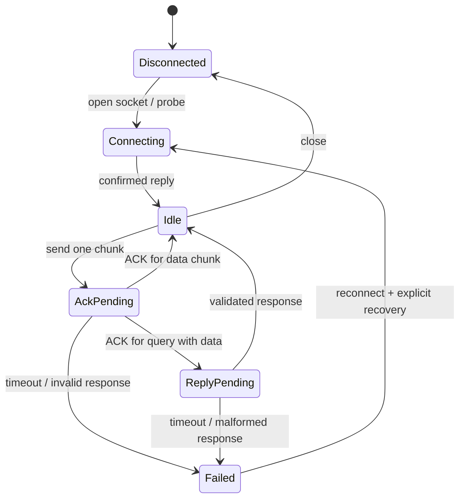

# Transport, besturing en jobstatus

**Status:** protocoldetails uit publieke implementaties (**OSS**), gekoppeld aan officiële gebruikersdocumentatie (**DOC**). Er zijn hier **geen livepakketten** naar een controller gestuurd en er is geen PCAP-capture van LightBurn gemaakt. De hoofdstukken maken daarom onderscheid tussen een aanbevolen eigen state machine en waargenomen appgedrag.

## Ethernet/UDP jobkanaal

Publieke implementaties gebruiken controllerpoort **50200** en hostpoort **40200** voor het primaire kanaal. Een payload van maximaal **1470 bytes** plus twee checksumbytes geeft 1472 bytes UDP-data, passend binnen een gebruikelijke 1500-byte IPv4/Ethernet-MTU zonder IP-fragmentatie. Behandel dit als conservatieve, te bevestigen configuratie; het is geen universele eigenschap van alle netwerkpaden.

```text
UDP datagram data:
  checksum_hi, checksum_lo, scrambled_payload...

checksum = sum(scrambled_payload) & 0xffff
```

De checksumbytes zijn gewone 8-bit big-endian waarden. Een bestaand `.rd` is al gescrambeld; split en checksum dat bestand zonder opnieuw te encoderen. Een encoder die nog raw commandobytes produceert scrambelt eerst en berekent daarna de datagramsom.

Oudere referentiecode knipt op maximale bytegrootte, eventueel midden in een commando. De onderzochte modernere MeerK40t-controller probeert groepen rond circa 1000 bytes bij commandogrenzen te vormen. Dit zijn verschillende keuzes van externe implementaties. Het packetiseringsgedrag van LightBurn is **OPEN**. Een herbouw kan commandobewuste chunks nemen zolang een werkelijk aangesloten firmware dat accepteert; test ook chunkgrenzen binnen lange records.

## ACK en andere antwoorden: twee bytewerelden

Bij magic 0x88:

| Logisch na unscramble | Op de wire | Naam in onderzochte publieke registry |
|---|---|---|
| CC | C6 | ACK |
| CD | 46 | ERR |
| CF | 48 | NAK |
| CE | C8 | ENQ |

Een oude bron beschrijft wire 46 globaal als fout en adviseert beperkt retrygedrag. De nieuwere implementatie onderscheidt ACK/NAK/ERR na unscrambling. Een driver moet responsebytes in exact één laag normaliseren. Vergelijk wire C6 niet met logische C6-poweropcodes.

Sommige queries krijgen zowel een ACK als een inhoudelijk antwoord. Een ACK bewijst niet dat het antwoord is ontvangen of dat een job is uitgevoerd. De openbare UDP-code heeft daarom aparte ACK_PENDING en REPLY_PENDING-states.

## Aanbevolen state machine — ONTWERP



Uploadstate staat boven deze transportstate: Prepared → Uploading → Uploaded → Stored/Verified → Started → Running → Completed/Failed. Firmware ondersteunt mogelijk geen afzonderlijke verification; rapporteer dan `Uploaded, not verified` en verzin geen succesniveau.

Werk met één in-flight request op het jobkanaal, geserialiseerde toegang en een bounded queue. Pauzeer statuspolling tijdens het versturen van jobchunks, zodat een status-ACK niet voor een upload-ACK wordt aangezien. De onderzochte MeerK40t-controller gebruikt hiervoor een joblock.

## Verlies en retries

UDP biedt op zichzelf geen volgorde, aflevering of duplicate protection. De onderzochte Ruida-pakketbeschrijving toont geen algemeen sequentienummer. Na een verloren ACK weet de host niet noodzakelijk of een chunk wel is verwerkt. Blind iedere timeout onbeperkt opnieuw sturen kan dubbele jobdata opleveren.

Voor een eigen implementatie:

1. Definieer per model welke requests idempotent zijn en hoe ERR/NAK wordt behandeld.
2. Valideer antwoordadres/poort en requesttype. Verwijder verouderde antwoorden bij een gecontroleerde reconnect.
3. Laat expliciete NAK en timeout verschillende herstelpaden volgen.
4. Markeer een halfgeüploade job als onzeker; vervolg niet automatisch met de volgende chunk.
5. Start nooit automatisch na een onzekere upload. Herstel via gedocumenteerde file-replace/restart-uploadprocedure.
6. Exporteer transferdiagnostiek: artifacthash, chunks, bytes, timers, antwoordtype en laatste bevestigde chunk.

De precieze LightBurn-timeouts, retryaantallen en foutdialogen zijn niet uit de offline export afleidbaar. Gebruik meetbare instellingen en fault-injectiontesten voordat je waarden kiest.

## Bestandsbeheer en directe machineacties

De publieke commandofamilies omvatten start/pause/stop/resume, home, jog/key events, settingqueries en documentopslag. Geheugenqueries gebruiken onder meer DA 00; de registry noemt status en X/Y/Z/U-adressen. Die zijn indicatief voor de onderzochte implementatie en niet automatisch een modelonafhankelijke API.

Aanbevolen publieke app-API:

```text
connect(profile)             → session(model, firmware, capabilities)
getStatus()                 → timestamp + known flags + unknown bits
getPosition()               → position + frame + freshness
upload(name, artifact)      → receipt
listFiles()                 → entries with stable/firmware IDs
runFile(id)                 → execution request result
pause / resume / stop       → separate runtime actions
jog(axis, distance, speed)  → bounded operation
readSettings()             → raw + typed snapshot
writeSettings(diff)        → acknowledged diff + readback
```

Een knop loslaten na jog/key-down kan een key-up vereisen. Een verbroken UI-focus mag geen blijvende jog laten lopen. Prefer bounded moves wanneer de backend dat ondersteunt; bedieningsbeleid en firmwarestopmechanisme moeten op hardware worden getest.

Het publieke vocabularium noemt ook poorten **50207/40207** voor een interface/frontpanelkanaal. Dat is geen tweede uploadpoort voor dezelfde jobdata. Gebruik dit pas na eigen verificatie van het juiste controller- en commandotype.

## USB en USB-stick

Er zijn minstens twee concepten:

- USB-stick / U-disk: RD-bestand op verwisselbaar medium, later door controller gelezen.
- Directe computer-USB: een device-/driververbinding met eigen buffering, identificatie en responseafhandeling.

De oude protocolbron vermeldt dezelfde RD-commandotaal als payload in meerdere media. Daaruit volgt niet dat Ethernetdatagramchecksums ook op USB horen. USB vendor/product-ID, endpointkeuze, chipdriver, framing, pacing en connect/disconnectgedrag zijn hier **niet vastgesteld**. De gevraagde publieke `usb_connection.py` bestond niet op het geprobeerde pad; er is daarom bewust geen verzonnen USB-driverbeschrijving toegevoegd.

Voor volledige herbouw zijn een gekoppelde USB-bench, officiële hardwaredocumentatie en captures van minimaal connect/query/upload/start/stop nodig. U-disk-bestandsnaam- en filesystembeperkingen moeten eveneens per model worden vastgesteld.

## Bridge en netwerkconfiguratie

DOC: LightBurn heeft een Bridge-workflow voor Ruida. Deze configureert een netwerkapparaat tussen computer en controller; de gebruikershandleiding beschrijft discovery en een apart controller-LAN. De gebruikte computer→Bridge-transporten zijn niet uit de bekeken setuphandleiding afgeleid. Neem dus geen universele Bridgepoort of een eigen TCP-wireprotocol aan.

Een eigen bridge kan een reliable RPC/upload-API aan de computerkant en lokale Ruida-UDP aan de machinekant gebruiken. Dat is een **eigen ontwerp**, geen LightBurn Bridge-compatibiliteitsclaim. Leg recovery, artifactidentiteit en overdrachtsstatus daarin expliciet vast.

## Ander UDP-protocol: automatisering van de LightBurn-app

Dit mag niet met Ruida worden verward. De officiële Automation with UDP-documentatie noemt appcommando’s op **19840** met antwoorden op **19841**. Commando’s omvatten LOADFILE, FORCELOAD, IMPORT, LASER, CLOSE, FORCECLOSE, START, STATUS en PING. Antwoorden zijn OK, ! of ?; STATUS en PING hebben eigen betekenis. Dit is een tekstinterface naar de desktopapp, niet de binaire RD-encoder.

Een vergelijkbare tool kan zo’n automation facade aanbieden bovenop command registry en jobcontroller. Force-load/force-close slaan dirty checks over en vereisen daarom een duidelijk API-contract. Het bestaan van deze API is DOC-bevestigd; in deze sessie zijn geen START- of forcecommando’s verzonden.

## Primaire bronnen

- [UDP-implementatie op onderzochte commit](https://github.com/meerk40t/meerk40t/blob/d511944e08788e88077727f682957759884ff5ca/meerk40t/ruida/udp_connection.py)
- [Controller/spooling op onderzochte commit](https://github.com/meerk40t/meerk40t/blob/d511944e08788e88077727f682957759884ff5ca/meerk40t/ruida/controller.py)
- [Oudere onafhankelijke protocolobservaties](https://github.com/jnweiger/ruida-laser/blob/a1e7b9b93b10d5cac79c875bc3efec46f7397a11/doc/protocol.md)
- [Officiële Ethernet-guide](https://docs.lightburnsoftware.com/2.1/Guides/RuidaEthernet/)
- [Officiële Bridge-setup](https://docs.lightburnsoftware.com/2.1/Guides/LightBurnBridge/)
- [Officiële appautomatisering](https://docs.lightburnsoftware.com/2.1/Guides/AutomationWithUDP/)
